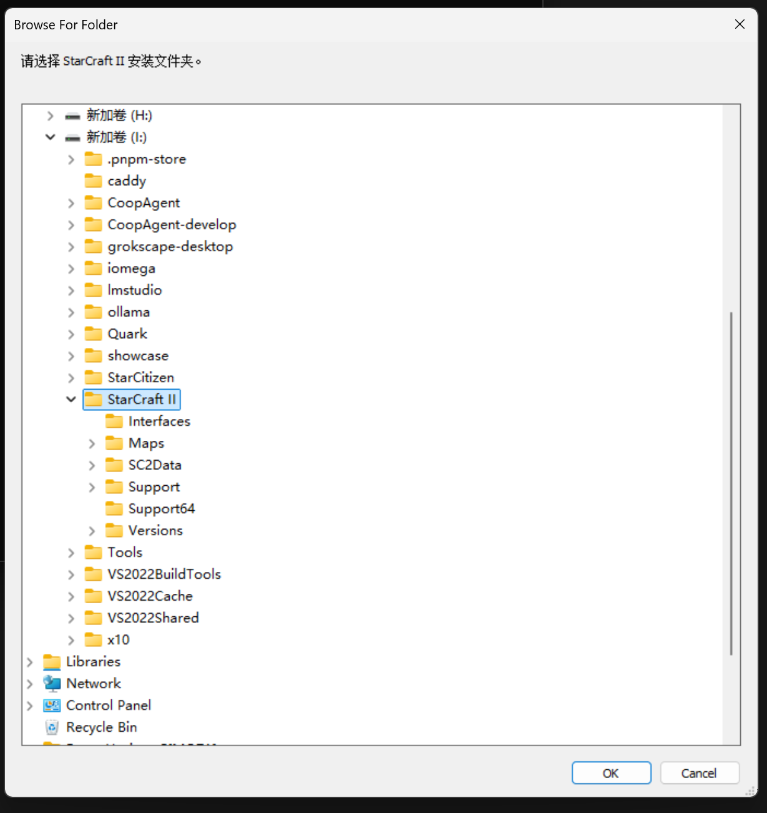
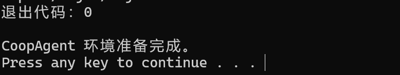
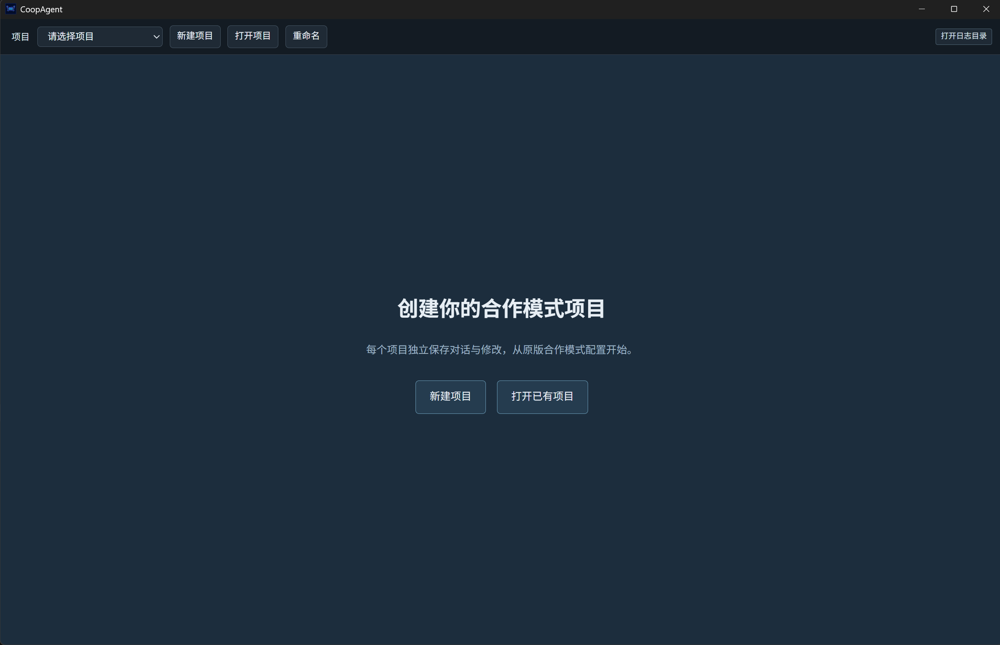

# Installation Guide

[简体中文](getting-started.md) | English

This guide covers installation from source on Windows x64. Run the commands below from the repository root. Initial setup and compilation may take some time.

After installation, follow the [User Guide](user-guide.en.md) to create a project, configure a model, and make your first change.

## Prerequisites

- *StarCraft II* installed.
- Python 3.10 or later, **64-bit**, with `python` available from the command line ([official download](https://www.python.org/downloads/windows/) · [official Windows installation instructions](https://docs.python.org/3/using/windows.html)); Git for Windows available from the command line.
- Visual Studio 2022 or 2026 C++ Build Tools: MSVC, MSBuild, CMake, and the Windows SDK. If these are missing, see [Installing C++ Build Tools](install-cpp-build-tools.en.md).
- A working model API configuration.
- At least 20 GiB of free disk space is recommended for the toolchain, game database, and build caches.

`setup.cmd` checks the required system components before downloading tools and shows installation instructions if anything is missing.

## Install and launch

1. Clone the CoopAgent repository with Git: `git clone https://github.com/ZHHHCY/CoopAgent.git`, then open the `CoopAgent` folder.
2. Double-click `setup.cmd`.
3. In the folder picker, select your StarCraft II installation directory as shown below, then click **OK**.

   

4. Wait for setup to finish. The script installs tools at fixed versions and builds the Co-op database from your local game data. The completed setup looks like this:

   

5. Double-click `start.cmd` to launch the application. The first launch builds the desktop application and can take a while. Once it opens, you should see this:

   

6. Continue with the [User Guide](user-guide.en.md).

You can also specify the game directory from the command line:

```powershell
.\setup.cmd -StarCraftRoot "D:\Games\StarCraft II"
```

## Installation or startup problems

If downloading, extraction, or database preparation is interrupted, run `setup.cmd` again. The script resumes archive downloads, removes incomplete temporary directories, reuses complete CASC extraction results, and replaces the database only after the new build is complete. Only one setup process can run at a time.

If the database is not ready or a query fails, click **重新检查** (Check Again) in the environment settings or the **全部改动** (All Changes) area. **打开日志目录** (Open Log Directory) opens `.coopagent/logs/` in the current repository. Files named `setup-*.log`, `start-*.log`, and `app-*.jsonl` record setup, startup, and application errors respectively. **查看技术详情** (Technical Details) in an error message shows the original error, which you can ask the agent to analyze.

After updating the source code, close the desktop application, run `scripts\build.cmd` to rebuild it, then run `start.cmd`. Use `scripts\dev.cmd` for development with hot reload.

## Resetting the environment

Close CoopAgent, development terminals, and the StarCraft II Editor before running `reset.cmd`. By default, it clears only the current repository's toolchain, dependencies, and build caches. Projects, sessions, changes, logs, the shared database, and model credentials are preserved.

```powershell
.\reset.cmd --check               # Preview the default cleanup targets without deleting anything
.\reset.cmd -DeleteProjects       # Also delete projects under the current projects folder, including their sessions and changes
.\reset.cmd -ClearSharedData      # Also clear the shared database, CASC and WebView caches, and saved game path
```

The extra cleanup options require typing `RESET` to confirm. You can combine both options. Projects outside the repository and model credentials are preserved. The folder picker appears again on the next run of `setup.cmd` only if the shared game path has been cleared.

Environment tools are stored under the repository's `.tools/` folder and `%LOCALAPPDATA%\CoopAgent\`. The game directory is recorded in `%APPDATA%\CoopAgent\sc2-installation.json`; the local database is under `%LOCALAPPDATA%\CoopAgent\database\<SC2 build>`. These generated files are not distributed with the repository.
