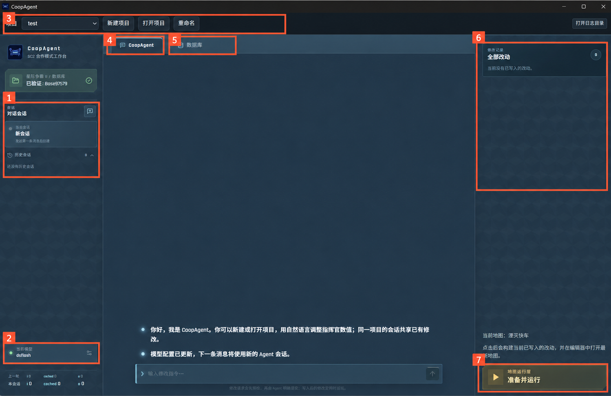
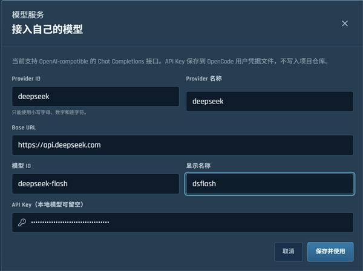
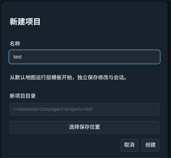
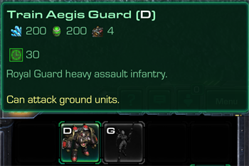
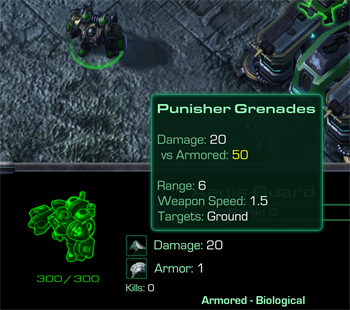

# User Guide

[简体中文](user-guide.md) | English

## Launch and preparation

Complete these steps before using CoopAgent:

1. Run `start.cmd` from the repository root to open CoopAgent.
2. Open a project. On first use, you will be asked to create one. Later launches automatically reopen the last project.
3. Configure a working model API.

The interface defaults to Simplified Chinese. Use the language selector at the top right of the project toolbar to switch to English. Your choice is saved automatically and takes effect immediately, without restarting or recreating your current project or session.

## Interface overview

### 1. Session management

Click the plus button next to **对话会话** (Chat Sessions) to create a session. Previous sessions appear below; click one to switch to it. When asking the agent to make a new change unrelated to the previous conversation, starting a new session can reduce context costs.

### 2. Model configuration

Click the model card at the bottom left to open model management and add a model configuration. Here is an example:

You can choose your own Provider ID. It may contain only lowercase letters, digits, and hyphens, must begin with a letter or digit, and must be no longer than 48 characters. Provider name and display name are used in the interface and can be chosen freely. Enter the Base URL, model ID, and API key exactly as provided by your model service provider.

### 3. Project management

Use the dropdown at the top to switch projects. The buttons beside it let you create, open, or rename a project.

Each project stores its own sessions, changes, and map content. New projects start from the original Co-op configuration; opening an existing project restores its saved content. Sessions within the same project share the changes already made. Create a new project to try a different set of changes. By default, projects are stored in the `projects/` folder inside the CoopAgent directory, but you can choose another location.

### 4. Chat (CoopAgent)

This is the page for chatting with the agent.

### 5. Database

Switch to the **数据库** (Database) tab to browse commander level upgrades, units, and top-bar abilities.

As shown above, first click the plus button at the top left and select a commander. Parsing the data takes some time. Once it finishes, the commander's upgrades, units, top-bar abilities, mastery, prestige, and other information are listed. Click an item to display its details below:

The data on this page is parsed from game files. Some units may be missing, and some values may differ from what you see in the game. Use it as a reference.

### 6. Change history

**全部改动** (All Changes) on the right shows changes already applied to the current project, including what changed, the before and after values, and when the change was applied.

### 7. Launch button

Click **准备并运行** (Prepare and Run) to build the current project's map and open it in the editor. Sometimes the game does not start automatically; press `Ctrl+F9` in the editor's main window. If the editor is already open and the agent makes new changes, the button becomes **更新并运行** (Update and Run). Click it before entering the game so the new changes are loaded.

## Querying and making changes

When chatting with the agent, it is a good idea to first ask about the unit or value you want to change. In-game values can result from several factors combined, so database fields may differ from the final values in the game. Asking first lets you check the agent's understanding before requesting a change, helping avoid unnecessary exploration, guesses, and token costs. For simple fields such as health or cost, you can usually request a change directly without a preliminary query.

The time needed for one agent turn currently varies considerably, from around one minute to more than ten minutes. Avoid submitting too many tasks at once.

Here is an example. First, I asked the agent to look up Mengsk's Aegis Guard attributes. The agent may also infer the unit from a nickname such as “the emperor's bald guy,” but this adds overhead and uncertainty. The query result is shown below:

Then I asked the agent to change the cost and weapon damage:

Once the agent finishes, click **准备并运行** (Prepare and Run) at the bottom right and wait for the game to start. If it does not, press `Ctrl+F9` in the editor's main window.

In the game, you can see that the cost and weapon damage have changed as requested: the cost is 200 minerals and 200 gas, and damage against armored targets is 50 = 20 base damage + 30 bonus damage against armored targets.

| Training cost | Weapon damage |
| --- | --- |
|  |  |

If something is missing or does not work as expected, return to the same session and give the agent feedback. If you make more changes after the game ends, click **更新并运行** (Update and Run) to prepare the latest map.

## About local testing

Co-op configurations customized through the agent can currently only be played in the editor. Only Oblivion Express is supported. Multiplayer is unavailable, and the ally is always Raynor.

When choosing a commander, you will see a **测试模式** (Test Mode) switch. Enabling it gives you 5,000 minerals, 2,000 gas, and 200 supply at the start of the game so you can test changes sooner.

## Troubleshooting

If the database is not ready or a query fails, click **重新检查** (Check Again) in the environment settings or the **全部改动** (All Changes) area. For logs, rebuilding the application, or preparing the environment again, see [Installation or startup problems](getting-started.en.md#installation-or-startup-problems).
